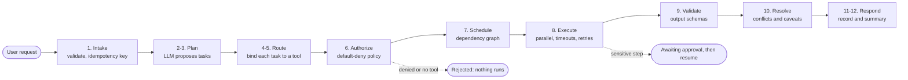
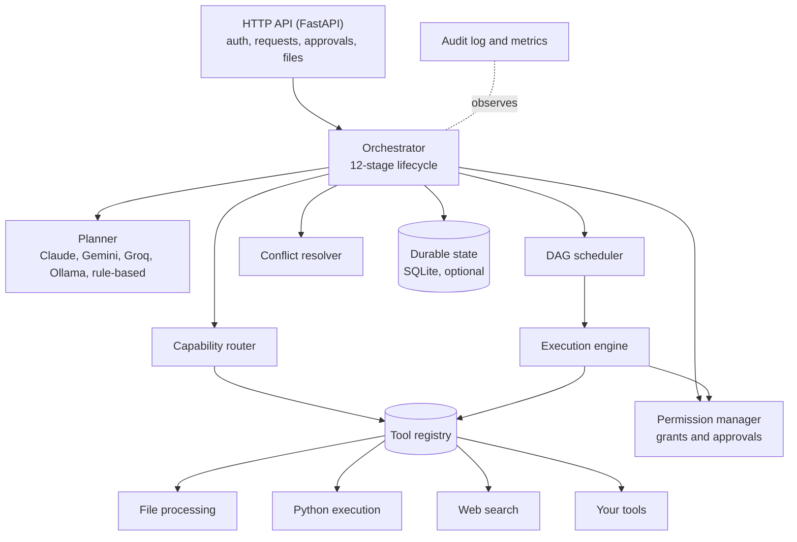
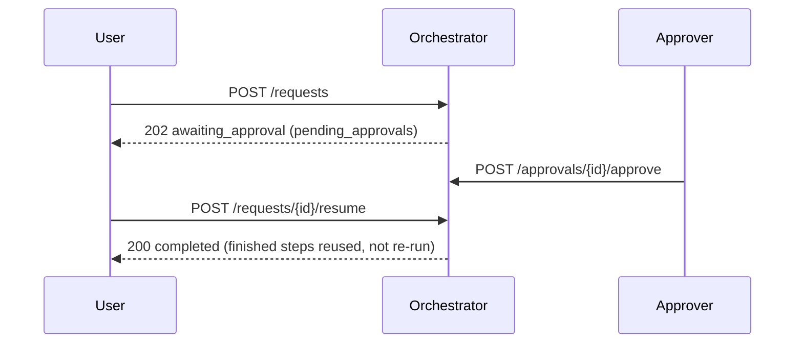

# Multi-Tool Orchestrator Agent

[](https://github.com/NihaalNO/multi-agent-orchestrator/actions/workflows/ci.yml)


**Turn a plain-language request into a safe, parallel, audited run across many tools.**

You ask: *"Read sales.csv, calculate the average revenue using Python, and search for the latest
industry benchmarks."* The orchestrator plans the work with an LLM, picks the right tool for each
step, checks that you are allowed to do every step, runs independent steps at the same time,
cross-checks the results, and returns one consolidated answer — with every decision on record.

> **The core rule: the LLM proposes, deterministic Python decides.**
> The model only suggests a plan. Everything that matters — which tool runs, whether you may run
> it, on which file, with which arguments — is checked by ordinary, tested code. A model cannot
> grant itself permissions, invent a tool, or slip a different file past the permission check.

---

## Contents

1. [Highlights](#highlights)
2. [Try it in 30 seconds](#try-it-in-30-seconds)
3. [How a request flows](#how-a-request-flows)
4. [Architecture](#architecture)
5. [Installation](#installation)
6. [LLM providers and web search](#llm-providers-and-web-search)
7. [Security model](#security-model)
8. [Running the server](#running-the-server)
9. [Using the API](#using-the-api)
10. [Built-in tools](#built-in-tools)
11. [Receipts: proof of what ran](#receipts-proof-of-what-ran)
12. [Grounded answers: explainable responses](#grounded-answers-explainable-responses)
13. [Trustworthy results: conflicts and caveats](#trustworthy-results-conflicts-and-caveats)
14. [Reliability: retries, duplicates, restarts](#reliability-retries-duplicates-restarts)
15. [Observability](#observability)
16. [Extending the orchestrator](#extending-the-orchestrator)
17. [Examples](#examples)
18. [Testing and CI](#testing-and-ci)
19. [Project structure](#project-structure)
20. [Status and known limitations](#status-and-known-limitations)
21. [Documentation](#documentation)

---

## Highlights

| Capability | What it means in practice |
|---|---|
| **Dynamic tool registry** | Add, replace, enable, disable or health-check tools while the server runs. Tools declare *capabilities* (`web.search`, `data.compute`), not hard-wired names. |
| **Capability-based routing** | Each step is matched to the best available tool that provides the needed capability, ranked by reliability, cost and latency. |
| **Five planners** | Claude (default), Google Gemini, Groq, Ollama (local, no key), or an offline rule-based planner. Llama models run through Groq or Ollama. |
| **Default-deny permissions** | Role- and user-based grants per tool, operation, access level and *resource* (e.g. `file:users/{user_id}/*`). Deny rules always win. |
| **Human approvals** | Sensitive operations (deletions, payments…) pause until a different person approves those exact arguments. |
| **Parallel execution** | Independent steps run concurrently; dependent steps wait only for what they need. Timeouts, safe retries and concurrency limits included. |
| **Conflict resolution** | Duplicate, contradictory, stale or incomplete results are detected. Clear cases are resolved by stated rules; unclear ones are flagged for review — never guessed. |
| **Duplicate protection** | Re-sending a request (or a write) with the same idempotency key does not run it twice — even after a restart. |
| **Durable state** | Requests, approvals and duplicate records survive restarts (SQLite, optional). |
| **File uploads** | Upload files over the API into per-user folders, with size, type and path checks. |
| **Live web search** | Through Claude's or Gemini's built-in web search; sources come from the API, not from model-written text. |
| **Full audit trail** | Every routing choice, permission decision, approval, retry and conflict is logged with request and task ids. Secrets are redacted. |

---

## Try it in 30 seconds

No API key, no network, no database:

```powershell
python -m venv .venv
.\.venv\Scripts\python -m pip install -e ".[dev]"
.\.venv\Scripts\python examples\mvp_demo.py
```

This runs the specification's MVP request through the **entire** pipeline — planning, routing,
permission checks, parallel execution, conflict resolution — and prints:

```text
Request 418b023d4d3a487fa3abcac411eeeb30: completed.
Execution status: succeeded.
- load_file [file_processing.read_csv]: succeeded, 12 ms
- compute_mean [python_exec.run]: succeeded, 221 ms
- web_search [web_search.search]: succeeded, 1 ms
Conflicts: 1 detected, 1 resolved, 0 need review.

Average revenue: {"column": "Revenue", "mean": 129325.0, "count": 6}
Search results after de-duplication: 1
  - [SAMPLE] Industry revenue benchmarks 2026  (found by web_search)

Stage timings (ms): {'plan_route_authorize': 1.636, 'execute': 233.426, 'resolve': 0.482, 'total': 235.615}
Tool success rates: {'file_processing': 1.0, 'python_exec': 1.0, 'web_search': 1.0}
```

What happened: the file read and the web search ran **in parallel**; the average waited for the
file; the two sample search results pointed to the same page (one with a tracking parameter), so
the conflict resolver **merged the duplicate**. The demo's search results are labelled `[SAMPLE]`
because it runs offline.

With a real LLM (each run costs a little API usage):

| Command | Needs |
|---|---|
| `examples\mvp_demo.py --planner anthropic --search anthropic` | Anthropic key or `ant auth login` |
| `examples\mvp_demo.py --planner gemini --search gemini` | `GEMINI_API_KEY` |
| `examples\mvp_demo.py --planner groq` | `GROQ_API_KEY` |
| `examples\mvp_demo.py --planner groq --model llama-3.3-70b-versatile` | same — plans with Llama |
| `examples\mvp_demo.py --planner ollama` | a local [Ollama](https://ollama.com) server with the model pulled |

---

## How a request flows



| Stage | What happens | Where |
|---|---|---|
| 1. Intake | Request validated; a repeated `Idempotency-Key` returns the earlier request | `core.py` |
| 2–3. Plan | The planner turns text into small tasks with dependencies. It only sees tools the user could ever use. Its output is treated as **untrusted**. | `routing/*_planner.py` |
| 4–5. Route | Each task gets a registered, available, *permitted* tool that really provides the capability. A hallucinated tool name is overridden and logged. | `routing/router.py` |
| 6. Authorize | Every task is checked against the policy. Files/records are identified from the real arguments, not from the plan. | `permissions/` |
| 7–8. Execute | Tasks start as soon as their own inputs are ready. Final permission check, approvals, timeouts, retries, write locks. | `execution/` |
| 9. Validate | Every tool output is checked against the tool's declared schema. | `execution/engine.py` |
| 10. Resolve | Duplicates merged, contradictions settled or escalated, partial failures and stale data reported. | `resolution/` |
| 11–12. Respond | One record: plan, routing, permissions, results, conflicts, caveats, summary, timings. | `core.py` |

---

## Architecture



| Component | Responsibility | Module |
|---|---|---|
| HTTP API | Authentication, request/approval/file endpoints, admin | `api/` |
| Orchestrator | Runs the lifecycle, stores request records, resumes after approval | `core.py` |
| Planners | Turn text into a proposed plan; shared prompt, schema and parser | `routing/` |
| Router | Capability matching, ranking, re-verifying proposed bindings | `routing/router.py` |
| Registry | Runtime tool registration, discovery, health, schema validation | `registry/` |
| Permissions | Default-deny grants, resource scoping, approvals | `permissions/` |
| Scheduler & engine | Dependency-aware parallel execution, retries, idempotency, locks | `execution/` |
| Conflict resolver | Duplicates, contradictions, staleness, escalation | `resolution/` |
| Durable state | SQLite stores for requests, approvals, idempotency | `state.py` |
| Uploads | Safe file storage behind `/files` | `uploads.py` |
| Observability | Audit log, metrics, JSON logging | `observability/` |

Design decisions and their reasons are recorded in [docs/ARCHITECTURE.md](docs/ARCHITECTURE.md).

---

## Installation

**Requirements:** Python **3.11 or newer** (CI tests 3.11 and 3.14 on Linux, 3.14 on Windows).

```powershell
python -m venv .venv
.\.venv\Scripts\python -m pip install -e ".[dev]"     # everything, incl. test tools
```

Optional extras keep a production install lean:

| Install | Adds | Needed for |
|---|---|---|
| `pip install .` | core + Anthropic SDK | Claude planner/search, rule-based planner |
| `pip install ".[gemini]"` | `google-genai` | Gemini planner and search |
| `pip install ".[openai-compat]"` | `openai` (used only as an HTTP client) | Groq and Ollama planners |
| `pip install ".[dev]"` | all of the above + pytest | development |
| `pip install -r requirements.lock` then `pip install --no-deps .` | the exact tested versions of everything | reproducible deployments (what Docker uses) |

---

## LLM providers and web search

Every provider receives **the same prompt and output schema**, and its output goes through
**the same parser and checks** — so switching providers never weakens validation.

| Provider | `ORCH_LLM_PROVIDER` | Default model | Credentials |
|---|---|---|---|
| Anthropic Claude *(default)* | `anthropic` | `claude-opus-5-5` | `ANTHROPIC_API_KEY`, `ANTHROPIC_AUTH_TOKEN`, or `ant auth login` |
| Google Gemini | `gemini` | `gemini-3.8-flash` | `GEMINI_API_KEY` (or `GOOGLE_API_KEY`) |
| Groq | `groq` | `openai/gpt-oss-120b` | `GROQ_API_KEY` |
| Ollama | `ollama` | `gpt-oss:20b` | none locally; `OLLAMA_API_KEY` for Ollama's cloud |
| OpenAI-compatible | `openai` | none: set `ORCH_LLM_MODEL` | `OPENAI_API_KEY` (not needed for a local server); endpoint `OPENAI_BASE_URL` or `ORCH_LLM_BASE_URL`, default `https://api.openai.com/v1` |
| Offline | `rule_based` | — | none (keyword rules; good for tests and demos) |

- **Change the model** with `ORCH_LLM_MODEL`, the key with `ORCH_LLM_API_KEY`, Claude's depth with
  `ORCH_LLM_EFFORT` (`low` … `max`), and the Groq/Ollama/OpenAI-compatible endpoint with `ORCH_LLM_BASE_URL`.
- **Any OpenAI-compatible server** (OpenAI itself, a gateway such as OpenRouter, or a local vLLM or
  LM Studio): `ORCH_LLM_PROVIDER=openai`, the key in `OPENAI_API_KEY`, the server in `OPENAI_BASE_URL`
  (or `ORCH_LLM_BASE_URL`, which wins), and the model name it serves in `ORCH_LLM_MODEL`. On
  `api.openai.com` plans use strict JSON Schemas; other servers get JSON mode with the schema in the
  instructions (set `ORCH_LLM_JSON_MODE=json_schema` if yours enforces schemas). A local server needs no key.
- **Llama models:** `ORCH_LLM_MODEL=llama-3.3-70b-versatile` on Groq, or `llama3.3` on Ollama.
  (Meta's own API now serves Meta's Muse models, not Llama, so it is not a provider here.)
- **Output strictness:** most providers enforce the plan's JSON schema. Llama models on Groq and
  Ollama's cloud only guarantee *valid JSON*, so the schema goes into the instructions instead and
  such plans are rejected more often — but never run unchecked. Override with `ORCH_LLM_JSON_MODE`.

**Web search** is separate from planning and off by default:

| `ORCH_SEARCH_BACKEND` | What you get | Note |
|---|---|---|
| `none` *(default)* | no web search tool | requests needing search are answered partly, with a caveat |
| `anthropic` | Claude's server-side web search | snippets are **quotes from the page**; results carry dates when available |
| `gemini` | Gemini with Google Search grounding | snippets are the **model's sentence** attributed to a source (a summary, not a quote); no dates |
| `tavily` | Tavily's search API (`TAVILY_API_KEY`, from [app.tavily.com](https://app.tavily.com/)) | snippets are **quotes from the page**; dates when available; one HTTPS call, no model involved; 1 credit per search (`ORCH_TAVILY_SEARCH_DEPTH=advanced`: 2) |

In every live backend, titles and URLs come from the API's own metadata — a model cannot invent a
source. Tavily works with any planner, so it is the way to get web search with Groq or Ollama.

---

## Security model

### 1. Authentication — who are you?

Clients send `Authorization: Bearer <api key>`. The server stores only **SHA-256 hashes** of keys
(in `config/principals.json`) and compares in constant time. Each key maps to a user id and roles.
`/health` and the chat page's static files (`/ui`) are the only public endpoints; the page itself
holds no data and calls the API with the key you type in. No principals file → nobody can log in.

### 2. Authorization — what may you do?

Everything is **denied unless a grant allows it**. A grant names a subject, a tool, an operation,
a maximum access level and, optionally, resource patterns:

```json
{"subject": "role:analyst", "tool_id": "file_processing", "max_access": "read",
 "resources": ["file:users/{user_id}/*", "file:shared/*"]}
```

| Field | Meaning |
|---|---|
| `subject` | `role:<name>` or `user:<id>` |
| `tool_id` / `operation` | exact name or `*` |
| `max_access` | `read` < `write` < `execute` < `admin` — a grant covers its level and below |
| `resources` | glob patterns over resources like `file:<path>`; `{user_id}` means *the caller's own id*, so one grant gives everyone a private folder |
| `effect` | `"deny"` rules override every allow they match |
| `allow_sensitive` | lets sensitive operations be *requested* — they still need an approver |

How a decision is made: matching **deny** rules win → an **allow** must cover the operation's
access level and the resource → **sensitive** operations additionally need approval → otherwise
**denied**. Patterns match case-insensitively, so `PRIVATE/` cannot sneak past a rule for
`private/`.

Permissions are checked **four times**: the planner only sees usable tools; the router only picks
permitted tools; the whole plan is authorized; and each task is checked again right before it
runs, with its real arguments.

### 3. Approvals — sensitive operations

A sensitive call stops with `awaiting_approval`. An **approver** (never the requester) approves it;
the approval is **single-use**, **expires**, and is bound to a hash of the **exact arguments** —
approving "delete record 5" cannot be reused for "delete record 6".

### 4. Untrusted input

- The user's text is marked as data in the planner prompt, so instructions hidden in it are not
  followed.
- Proposed tool names are re-verified; unknown or unsuitable ones are replaced and logged.
- The file or record a step touches is derived from its actual arguments (and normalised, so
  `reports/../secret.csv` is treated as `secret.csv`).

### 5. Files and code

- The file tool can only read inside the upload folder: no absolute paths, `..`, hidden files or
  symlink escapes.
- Uploads have their own permission (`tool_id: "uploads"`), so a plan can never write or delete
  files.
- **Python runs in a WebAssembly sandbox.** CPython compiled for WASI runs inside wasmtime: no
  host files except a read-only standard library and an empty scratch folder, no network, no
  environment variables, a memory cap (`ORCH_PYTHON_MEMORY_MB`) and a time limit enforced by the
  runtime. Only the standard library is available. Fetch the build once with
  `python scripts/fetch_python_wasm.py` (SHA-256 checked); the Docker image includes it and sets
  `ORCH_PYTHON_SANDBOX=wasm`. Without it, `auto` falls back to a plain subprocess — not a security
  boundary — and says so at startup.

The full checklist is in [docs/DEPLOYMENT.md](docs/DEPLOYMENT.md#security-checklist).

---

## Running the server

**1. Create your configuration** from the examples (your real copies are git-ignored):

```powershell
Copy-Item config\policy.example.json config\policy.json; Copy-Item config\principals.example.json config\principals.json
```

The example policy gives analysts a private folder (`users/<their id>/`), read access to
`shared/` (except `shared/restricted/`), web search and Python; admins get everything.

**2. Create an API key** for each user and put the printed hash in `config\principals.json`
(the key itself is shown once — give it to the user):

```powershell
.\.venv\Scripts\python -m orchestrator hash-key --generate
```

**3. Check, then start:**

```powershell
$env:ORCH_POLICY_PATH = "config\policy.json"; $env:ORCH_PRINCIPALS_PATH = "config\principals.json"; $env:ORCH_STATE_PATH = "data\state\orchestrator.db"
```

```powershell
.\.venv\Scripts\python -m orchestrator check-config
```

```powershell
.\.venv\Scripts\python -m orchestrator serve
```

`check-config` catches common mistakes before you start — for example:

```text
environment=development planner=rule_based model=None search=none uploads=data\uploads
WARNING principals file still contains the example placeholder hashes.
WARNING ORCH_STATE_PATH is not set: requests, approvals and duplicate protection are kept in memory and lost on restart.
WARNING ORCH_SEARCH_BACKEND is 'none': no web search tool is registered, so requests that need web search are only partly answered (or rejected).
```

`serve` refuses to start on configuration **errors** (for example a missing Gemini key or an
unreadable policy) and prints them plainly. Interactive API docs are at
`http://127.0.0.1:8000/docs` while it runs.

### Command line

| Command | Purpose |
|---|---|
| `python -m orchestrator serve [--host] [--port] [--proxy-headers]` | run the API with JSON logging |
| `python -m orchestrator hash-key [--generate]` | hash an API key, or create a new one |
| `python -m orchestrator check-config` | validate settings, policy, principals, keys and state file |

### Docker

With `config\policy.json` and `config\principals.json` created as in steps 1–2:

```powershell
Copy-Item .env.example .env          # then fill in the key(s) for your provider
docker compose up -d
```

The image runs as a non-root user, keeps uploads, the audit log and durable state in `./data`,
mounts `./config` read-only, has a health check, and listens on `127.0.0.1:8000` only — put a
TLS-terminating reverse proxy in front to expose it. CI builds and smoke-tests the image on every
push.

### Most important settings

| Setting | Default | Purpose |
|---|---|---|
| `ORCH_LLM_PROVIDER` / `ORCH_LLM_MODEL` | `anthropic` / provider default | which planner and model |
| `ORCH_SEARCH_BACKEND` | `none` | `anthropic`, `gemini`, `tavily` or `none` |
| `ORCH_POLICY_PATH` / `ORCH_PRINCIPALS_PATH` | unset | grants and API keys (unset = deny all / nobody logs in) |
| `ORCH_STATE_PATH` | unset | SQLite file for durable state (unset = in memory) |
| `ORCH_FILE_TOOL_ROOT` | `data/uploads` | the only folder files are read from and uploaded to |
| `ORCH_MAX_CONCURRENCY` | `8` | tool calls running at once |
| `ORCH_AUDIT_LOG_PATH` | unset | write the audit trail to a JSON-lines file |

All 32 settings are documented in [docs/DEPLOYMENT.md](docs/DEPLOYMENT.md#configuration).

---

## Using the API

### Chat in the browser

Open **http://127.0.0.1:8000/** (it redirects to `/ui`) and paste your API key. The page is a thin
client over the same endpoints shown below:

The design ("The Data Desk") borrows from business-paper data pages: a tinted paper ground, one
sturdy sans (Public Sans) with tabular figures, and large condensed figures (Barlow Condensed), both
self-hosted under `static/fonts/` (SIL OFL). Light and dark follow the system.

- type a request in plain English, or start from one of the example prompts; Enter sends,
  Shift+Enter adds a line; **Attach file** uploads to `users/<your id>/` for the next message;
- the left rail lists this conversation's questions with their status; follow-ups build on earlier
  replies ("now double it") — the chat sends the last five as `context`, and the plan references
  their results instead of retyping them; **New conversation** starts over;
- each reply leads with its result: a computed figure carries a **Source line** (its evidence key,
  the step that produced it, and whether code checked it), then the answer with citation chips and
  a verification line ("✓ 3 of 3 claims checked against the evidence"), gaps and caveats as
  callouts, and the evidence list;
- beside it, the **steps** stay after the run: each with its tool, time and a bar drawn to its
  duration, expandable to its code, inputs and output, then the total, the **receipt** with
  **Copy receipt** (the signed JSON, ready for `verify-receipt`) and **Replay steps**;
- while it runs, the same steps panel fills in live (via `POST /requests/stream`), and a status
  region announces each phase to screen readers;
- the status never overstates: "Results ready · no written answer" when the answer could not be
  written, plain-language reasons for rejections, with what the agent can do instead;
- if a step needs approval, approvers get Approve / Deny buttons and then **Continue** resumes the request.

The key is kept in the tab's `sessionStorage` only (cleared when the tab closes). The page is served
with a strict Content-Security-Policy (no inline or third-party scripts) and renders all server text
as plain text.

### Upload a file, then ask about it

```powershell
Invoke-RestMethod -Method Put -Uri http://127.0.0.1:8000/files/users/alice/sales.csv -Headers @{ Authorization = "Bearer <your api key>" } -InFile .\sales.csv
```

```powershell
$h = @{ Authorization = "Bearer <your api key>"; "Idempotency-Key" = "report-001" }
Invoke-RestMethod -Method Post -Uri http://127.0.0.1:8000/requests -Headers $h -ContentType "application/json" -Body '{"text": "Read users/alice/sales.csv and calculate its average revenue using Python"}'
```

### What you get back

The response is the **request record**:

| Field | Contains |
|---|---|
| `state` | `completed`, `failed`, `awaiting_approval` or `rejected` |
| `plan`, `routing` | the tasks, and which tool runs each one and why |
| `authorization` | the permission decision for every task |
| `report.task_results` | each task's status, output, attempts and timing |
| `report.final_output` | the outputs of successful tasks |
| `report.resolved`, `report.conflicts` | reconciled values and every detected conflict |
| `report.uncertainty` | plain-language caveats ("the result is incomplete…") |
| `summary` | a readable text summary |
| `stages` | time spent planning, executing and resolving |
| `pending_approvals`, `requires_review` | what still needs a human |

HTTP status: `200` done · `202` awaiting approval · `403` not permitted · `422` nothing could
handle it · `503` planner unavailable or misconfigured.

### When an approval is needed



### Endpoints

| Endpoint | Who | Purpose |
|---|---|---|
| `GET /health` | anyone | liveness |
| `GET /ui` (and `GET /` → redirect) | anyone | chat page (static; it asks for your key) |
| `GET /me` | any user | your id and roles |
| `POST /requests` | any user | submit a request |
| `POST /requests/stream` | any user | the same, as server-sent events: live progress, then the record |
| `GET /requests/{id}` | owner, admin | view a request |
| `POST /requests/{id}/resume` | owner | continue after approvals |
| `PUT /files/{path}` · `GET /files` · `DELETE /files/{path}` | per policy | upload, list, delete files |
| `GET /approvals` · `POST /approvals/{id}/approve` · `POST /approvals/{id}/deny` | approver | decide sensitive operations |
| `GET /approvals/{id}` | requester, approver | view an approval |
| `GET /tools` · `GET /tools/{id}` · `GET /capabilities` | any user | discover tools |
| `POST /admin/tools/{id}/enable` · `POST /admin/tools/{id}/disable` · `POST /admin/tools/health-check` | admin | manage tools |
| `GET /admin/metrics` | admin | success rates, retries, latency |

Full details, error codes and the complete record format: [docs/API.md](docs/API.md).

---

## Built-in tools

| Tool | Operations | Capabilities | Notes |
|---|---|---|---|
| **File processing** | `read_csv`, `read_text`, `list_files` | `data.tabular.load`, `file.read.csv`, `file.read.text`, `file.list` | read-only, confined to the upload folder, 5 MB cap |
| **Python execution** | `run` | `data.compute`, `code.python.execute` | separate process, time limit, no inherited secrets — *not* a sandbox |
| **Web search** | `search` | `web.search` | registered only with a real backend (`ORCH_SEARCH_BACKEND`) |

---

## Receipts: proof of what ran

Every finished request gets a **receipt** — hashes, ids and statuses, no data — signed with an
Ed25519 key (`ORCH_RECEIPT_KEY_PATH`; the dev server creates one) and chained to the previous receipt:

- the question, the **permission policy in force** and the plan, each as a SHA-256;
- every step: status, the hash of the **exact arguments that ran**, the hash of its **output**, and the
  approval it used and **who approved it**;
- the written answer's text and evidence hashes and each claim's check result;
- for follow-ups, the receipts of the earlier requests they built on.

Anyone with the public key (`GET /receipts/public-key`) can check a receipt **offline**, and
compare it with the request record to show nothing was changed afterwards:

```powershell
python -m orchestrator verify-receipt receipt.json --public-key pub.pem --record record.json
```

Editing one output in the record is reported (`step compute_average output: does NOT match the
record`); removing or rewriting a receipt breaks the chain (`--chain`, from `GET /admin/receipts`).
In the chat, each reply shows "Receipt #N · signed with key …" with **Copy receipt**, which puts the
signed receipt JSON on the clipboard.

**Replay** (`POST /requests/{id}/replay`, the Replay button in the chat) runs a finished request's
stored plan again — for real, under your current permissions, without re-planning — and compares
every step with the original: *same*, *changed* (with the paths that changed, e.g.
`rows.4.Revenue`), *failed*, or *not re-run* for steps with side effects, which are never repeated.
It also says whether the record still matches its receipt and whether your permissions changed.

## Grounded answers: explainable responses

With a Groq or Ollama planner (`ORCH_ANSWERS=auto`), the response also gets a written answer — and
the same rule applies as for plans: **the LLM proposes, code checks**.

1. **Evidence** is built from the steps that succeeded and numbered `E1`, `E2`…: a value computed by
   Python, each web result (title, site, date, quoted snippet), a file read. CSV rows are never sent;
   a CSV becomes its size and column names.
2. **The LLM writes the answer** from that evidence only, citing ids after each statement
   ("Revenue averaged 129,325 [E2]"), listing its claims with their evidence and what the evidence
   does not answer.
3. **Code checks every claim**: cited ids must exist, and every number must appear in the evidence it
   cites (thousands separators, the claim's own rounding and `%` allowed). Each claim is marked
   **checked**, **unverified** (with the number that was not found) or **no evidence**.

In the chat, citations are chips that jump to the evidence item, "How this answer is supported"
lists every claim with its mark (opened automatically when something is unconfirmed), and gaps are
shown, not papered over. If writing the answer fails, the request still succeeds with the
deterministic summary and says why. The audit log records counts only (`answer.composed`), never the
answer text. Anthropic and Gemini planners keep the deterministic summary for now.

---

## Trustworthy results: conflicts and caveats

Results are checked **after** they run, so the answer never claims more certainty than the evidence
supports.

| Situation | What happens |
|---|---|
| Two steps made the identical call | same output → merged; different output → cross-checked |
| Search results point to the same page | merged by normalised URL (tracking parameters, case, trailing `/` ignored) |
| Tasks the planner marked as cross-checks disagree | settled by, in order: format differences (`"200"` vs `200`) → majority of 3+ sources → newest source → clearly more reliable tool |
| No rule can settle it | **escalated**: the value is reported as unknown with every source's version, and `requires_review` is set |
| Some steps failed | reported as an incomplete result, with which steps and why |
| Two independent writes to the same record | flagged for review (the outcome depends on which ran last) |
| Data with old dates | flagged as possibly outdated |

---

## Reliability: retries, duplicates, restarts

- **Timeouts and retries** — only errors marked temporary are retried, with growing waits and a
  global cap. Operations that change data are **never retried after a timeout**, because the
  first attempt may already have taken effect.
- **Re-planning on plan errors** — a planner writes its plan before any data is read, so it can guess
  wrong (a column name, an output field). When read or compute steps fail for such a reason, the
  planner is shown the errors and the *shape* of the results (column names, types — not the data)
  and its corrected plan is routed, authorized and run; unchanged steps are reused. Bounded by
  `ORCH_MAX_REPLANS` (default 1), never used for writes, permissions or approvals, and always
  reported in the result.
- **Partial failure** — if a step fails, everything depending on it is skipped and independent work
  continues.
- **Duplicate protection** — the same `Idempotency-Key` returns the original request; data-changing
  calls run at most once per key, even if two copies arrive at the same moment.
- **Write locks** — two writes to the same file or record never interleave.
- **Durable state** (`ORCH_STATE_PATH`) — requests, pending approvals and duplicate records survive
  a restart. Requests that were mid-run when the server stopped are marked failed
  (`interrupted_by_restart`) and **never re-run automatically**, since they may already have had
  side effects. Single server only.

---

## Observability

| Signal | Where |
|---|---|
| **Audit trail** | every registration, routing decision, permission decision, approval, task start/finish/retry, conflict and request outcome — with request/task ids, secrets redacted. Written to `ORCH_AUDIT_LOG_PATH` (JSON lines) and optionally to the log. |
| **Metrics** | `GET /admin/metrics`: request outcomes and p50/p95 latency; per tool: calls, success rate, retries, latency |
| **Per-request timings** | the `stages` field of every request record |
| **Logs** | JSON lines on stdout (`ORCH_LOG_LEVEL`) |
| **Health** | `GET /health`, used by the Docker health check |

---

## Extending the orchestrator

### Add a tool

A tool is one class. Registering it makes it discoverable, routable, authorizable and executable —
no orchestrator changes:

```python
from orchestrator.contracts import AccessLevel, OperationSpec, ToolSpec
from orchestrator.tools import ToolAdapter

class EchoTool(ToolAdapter):
    spec = ToolSpec(
        tool_id="echo",
        name="Echo",
        description="Returns its input",
        operations=(
            OperationSpec(
                name="say",
                description="Echo a message",
                capabilities=("text.echo",),
                input_schema={"type": "object", "properties": {"msg": {"type": "string"}}, "required": ["msg"]},
                output_schema={"type": "object", "properties": {"msg": {"type": "string"}}},
                access=AccessLevel.READ,
            ),
        ),
    )

    async def op_say(self, args, ctx):
        return {"msg": args["msg"]}

await registry.register(EchoTool())
```

Then grant it in the policy — registering a tool authorizes no one. Mark operations `sensitive`
(needs approval) or `idempotent=False` (duplicate protection, no retry after timeouts) as
appropriate, and override `resource_for()` if the tool touches identifiable files or records.
The step-by-step guide is [docs/TOOLS.md](docs/TOOLS.md).

### Add a search backend or an LLM provider

- **Search:** implement `name`, `search(query, max_results)` and `health_check()` and pass it to
  `register_default_tools(..., search_backend=...)`.
- **LLM provider:** OpenAI-compatible providers need only a `ProviderProfile` entry in
  `routing/openai_compat_planner.py`; others reuse `routing/llm_common.py` (shared prompt, schema
  and parser) and add just the API call and error mapping.

---

## Examples

| Script | Shows |
|---|---|
| [`examples/mvp_demo.py`](examples/mvp_demo.py) | the spec's MVP request end to end; `--planner`, `--search` and `--model` switch to real LLMs |
| [`examples/custom_tool.py`](examples/custom_tool.py) | registering a new tool at runtime, then using it — and being refused without a grant |
| [`examples/approval_workflow.py`](examples/approval_workflow.py) | a sensitive deletion: request → approval by someone else → resume |

All three run offline and are executed by the test suite, so they stay working.

---

## Testing and CI

```powershell
.\.venv\Scripts\python -m pytest
```

- **326 tests** (one is skipped on Windows, where creating symlinks needs admin rights). They
  cover all ten essential scenarios from the specification, every provider (with fake clients),
  restarts, uploads and the examples.
- **Docs stay honest:** tests fail if a setting or endpoint is undocumented, a documented setting no
  longer exists, or a link in the docs breaks.
- **CI** ([workflow](.github/workflows/ci.yml)) runs on every push to `main` and every pull request:
  tests on Linux (Python 3.11 and 3.14) and Windows (3.14), the MVP example, and a Docker build that
  checks the image refuses to start without its configuration and serves `/health` with it.

---

## Project structure

```text
src/orchestrator/
├── api/            HTTP API: app, authentication, chat UI (static/)
├── contracts/      data models shared by every component
├── registry/       dynamic tool registry
├── routing/        planners (Claude, Gemini, Groq/Ollama, rule-based), router, shared LLM contract
├── permissions/    policy engine, approvals, config loaders
├── execution/      DAG scheduler, execution engine, idempotency, $ref resolution
├── resolution/     conflict detection and resolution
├── tools/          file processing, Python execution, web search (+ search backends)
├── observability/  audit log, metrics, JSON logging
├── core.py         the orchestrator: lifecycle, request records, resume
├── state.py        durable state in SQLite
├── uploads.py      file uploads
├── config.py       settings (ORCH_* environment variables)
└── __main__.py     command line: serve, hash-key, check-config
tests/              326 tests, mirroring the source layout
examples/           runnable workflows + sample data
config/             example policy and principals
docs/               specification, architecture, API, tools, deployment, roadmap
```

---

## Status and known limitations

All eight phases of the [specification](docs/SPEC.md) are complete, and every essential test
scenario passes. Since then the project has gained live web search, three more LLM providers,
durable state, file uploads and a browser chat. CI is green.

Be aware of:

- **Live runs so far use Groq only.** Groq (`openai/gpt-oss-120b`) has been run live through the API
  and the chat; Anthropic, Gemini and Ollama are tested against fake clients. Live web search needs
  an Anthropic or Gemini key.
- **Conversation memory is per chat tab.** The chat sends the ids of its last five completed
  replies with each message; reloading the page (or **New conversation**) starts fresh.
- **One server instance.** Durable state is a local SQLite file; running several servers needs a
  shared database and distributed locks.
- **Sandboxed Python has the standard library only** (no numpy or pandas), and each run starts a
  fresh WebAssembly instance (about 0.2–1 s).
- **Metrics reset on restart** (the audit log, if configured, is durable).
- **No license file yet** — the default copyright rules apply until one is added.

The next phases are planned in [docs/ROADMAP.md](docs/ROADMAP.md): a Python sandbox, live progress
and conversation memory (09); answers linked to their evidence, with signed, replayable receipts
(10); plan preview and saved workflows (11); policy simulation (12); cross-checking planners and MCP
tools under policy (13); provider scorecards (14).

---

## Documentation

| Document | Read it for |
|---|---|
| [docs/SPEC.md](docs/SPEC.md) | the original project specification |
| [docs/ARCHITECTURE.md](docs/ARCHITECTURE.md) | components, data contracts and every design decision with its reason |
| [docs/API.md](docs/API.md) | every endpoint, status code and the full request record |
| [docs/TOOLS.md](docs/TOOLS.md) | writing, registering and testing a tool; search backends |
| [docs/DEPLOYMENT.md](docs/DEPLOYMENT.md) | all settings, Docker, durable state, monitoring, security checklist |
| [docs/ROADMAP.md](docs/ROADMAP.md) | what is done, partial and still open, phase by phase |
